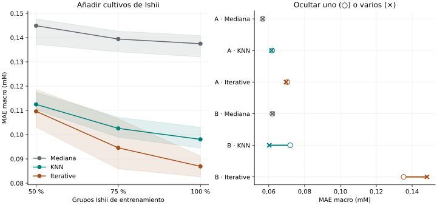

# Qué cambia al añadir cultivos o al ocultar varios metabolitos

**En Ishii, aumentar el número de cultivos del propio estudio redujo el error promedio de los tres métodos. Ocho condiciones adicionales de MMC2 no produjeron el mismo efecto que ocho cultivos de Ishii.** Con el entrenamiento Ishii completo, MMC2 sí ayudó a KNN en el panel común y mejoró la predicción de algunos metabolitos con Iterative. No hay una recomendación única para todos los objetivos.

Esta ejecución cubre los bloques 1 a 4 del plan. Parte de [la versión revisada](https://github.com/pedro1ani/Ipre/tree/f3d3b669b2d6b121649c9b23f97fec79decc89f5) y del [histórico](https://github.com/pedro1ani/Ipre/tree/3c6ab55a2bfcfc819b475916d530384e9cb78fb2). Las verdades son mediciones originales de Ishii. No se completaron huecos reales, no se eligió un método por metabolito y no se recalcularon intervalos bayesianos.

## 1. Qué datos entraron

La matriz documental contiene **42 filas y 27 variables**: 30 cultivos Ishii a D = 0,2 h⁻¹ (25 grupos de perturbación), cuatro WT a otras diluciones y ocho condiciones de MMC2. Se verificaron 1.078 posiciones con una fila analítica de origen contra los Excel; las otras 56 son las siete señales exclusivas de Ishii en las ocho filas MMC2. Una fila es un cultivo de Ishii o una condición auxiliar de Gerosa. La orientación, ya presente en el primer commit, permite excluir cultivos completos y estimar un metabolito con los demás. El historial no establece la intención de quien la eligió. Las ocho condiciones de MMC2 no son ocho réplicas de Ishii; MMC3 y MMC4 no agregan cultivos al entrenamiento.

El **panel de referencia para los experimentos nuevos contiene 20 metabolitos compartidos**. Los siete adicionales (glucosa-6-P, fructosa-6-P, ribulosa-5-P, malato, 3-fosfoglicerato, glucosa-1-P y ribosa-5-P) permanecen como predictores exclusivos de Ishii en la matriz documental; no se los trató como objetivos ni se inventó una medición equivalente de Gerosa. La cohorte principal conserva sus 30 cultivos y 457 mediciones en los 20 objetivos.

De 579 filas analíticas intracelulares, 149 alcanzan diez mediciones. Fuera de las 27 ya seleccionadas, **122 quedan como candidatas a revisión de identidad**, después de separar compuestos, etiquetas repetidas y señales de poco soporte. Esto no identifica 122 especies nuevas ni valida incorporarlas. El [inventario resumido](resultados/bloques_1_4/inventario_resumen.csv) distingue las decisiones; el inventario local incluye etiqueta, fila, protocolo, compartimento, unidad, mediciones, grupos y razón de exclusión.

Para que una columna entre en un ajuste se exigieron en su entrenamiento Ishii diez observaciones, cinco grupos, dos valores distintos y dos predictores con cinco pares medidos. En los cinco entrenamientos externos resultaron elegibles 15–16 columnas del panel común (17 con mínimo ocho, 14–15 con doce) y 22–23 del panel de 27. Para el panel ampliado se reprodujeron 437, 416 y 404 respuestas con mínimos de 8, 10 y 12. La sensibilidad con cuatro WT adicionales, incluidos únicamente cuando WT estaba en entrenamiento, tampoco dio una ventaja uniforme entre fuentes y métodos. Se conservan los 30 para la prueba principal. [Elegibilidad por bloque](resultados/bloques_1_4/elegibilidad.csv) · [Contrastes de umbral, WT y escala robusta](resultados/contrastes.csv).

## 2. Reproducción y unidad de evaluación

Se reprodujo la validación histórica y la evaluación en mM del panel común: los seis ajustes respondieron en las mismas **416 de 457 celdas (91,0 %), 16 metabolitos y 25 grupos**. Las 41 abstenciones individuales se deben a objetivos no elegibles en el bloque correspondiente. La diferencia máxima frente a las predicciones archivadas fue menor que 1,2 × 10⁻¹⁴ mM. La ejecución de referencia del panel ampliado se reprodujo también en una copia separada.

Ishii ya expresa las concentraciones en mM. Para Gerosa se divide el valor en µmol/g de peso seco por 2,3 mL/g de peso seco: µmol/mL = mM. Las 20 referencias bajo glucosa son positivas, medidas y con desviación documentada; la incertidumbre del volumen no está cuantificada. Si x es la concentración, r la referencia constante positiva, μ y σ la media y desviación del entrenamiento, entonces (x/r − μ/r)/(σ/r) = (x − μ)/σ para σ positiva. Al mantener columnas, máscaras, opciones y límite de cero, la diferencia máxima en las predicciones actuales fue **1,13 × 10⁻¹⁴ mM** entre estandarizar los mM o los cocientes. Mediana trabaja en mM, KNN e Iterative se estandarizan solo con el entrenamiento, sin logaritmos. [Reproducción celda a celda resumida](resultados/bloques_1_4/reproduccion.csv).

Usamos **error absoluto medio (MAE) en mM por metabolito**. El RMSE da más peso a los errores grandes; el sesgo es predicción menos medición; MAE/IQR divide cada error por el rango intercuartílico del entrenamiento Ishii, idéntico en A/B y omitido solo para esa métrica si no es positivo. El macro da igual peso a cada metabolito evaluable; el micro, a cada medición distinta. MAE/Gerosa se conserva como histórico: un mismo error en mM recibe más peso si la concentración de referencia es pequeña. En los experimentos con repeticiones se promedian primero los errores de la misma celda y luego los de los metabolitos; no se promedian predicciones antes de calcular el error.

## 3. Cuánto ayudan más datos y de qué estudio

En cada uno de cinco bloques de prueba se apartaron grupos completos. Dentro de los 24 cultivos restantes se hicieron ocho órdenes reproducibles de grupos; se tomaron subconjuntos anidados del 50 %, 75 % y 100 % de los grupos. El más pequeño tenía 9–14 cultivos. Se fijaron allí las columnas elegibles y el IQR para toda esa comparación. Se prefijaron cinco vecinos uniformes y 50 rondas con tolerancia 0,001: ver más cultivos no permite cambiar los parámetros. **En siete de los 40 entrenamientos pequeños no había columnas elegibles**; se registran como abstenciones de esa comparación a todos los tamaños, sin relajar la elegibilidad. En el entrenamiento completo habría 15–16 columnas elegibles si se permitiese cambiar el panel.

| Entrenamiento, sobre las mismas mediciones | Mediana | KNN | Iterative |
|---|---:|---:|---:|
| 50 % de los grupos Ishii | 0,1375 | 0,1078 | 0,1020 |
| 75 % de los grupos Ishii | 0,1338 | 0,0975 | 0,0896 |
| 100 % de los grupos Ishii | 0,1324 | 0,0942 | 0,0828 |
| Desde el mismo 50 %, añadir exactamente ocho **cultivos Ishii** | 0,1334 | 0,0974 | 0,0860 |
| Desde el mismo 50 %, añadir exactamente ocho **condiciones MMC2** | 0,1775 | 0,1112 | 0,1281 |

MAE macro en mM: 391 celdas distintas con respuesta en al menos una repetición, 14 metabolitos y 25 grupos. Hubo 2.346 respuestas de 3.656 intentos repetidos por alternativa. Para igualar el número de filas se añadieron siempre grupos Ishii enteros o las ocho filas de MMC2; ambos brazos parten del mismo subconjunto y se prueban en los mismos grupos. Frente al 50 %, usar todos los grupos de Ishii redujo el MAE macro en los ocho órdenes para los tres métodos. Esos ocho órdenes comparten observaciones y no son ocho estudios independientes. El efecto tampoco implica que las filas de ambas fuentes tengan la misma información, ni identifica por separado los efectos del medio, la técnica y el crecimiento.

Al permitir **todo el entrenamiento Ishii disponible de cada bloque** y usar el panel común elegible de ese entrenamiento, el soporte cambia a 416 celdas. Los parámetros se eligen dentro de los tres bloques internos. Así se distingue añadir las ocho filas con los parámetros de A fijos de volver a elegirlos para B:

| Entrenamiento completo de cada bloque | Mediana | KNN | Iterative |
|---|---:|---:|---:|
| A: Ishii | 0,1216 | 0,0918 | 0,0867 |
| B: Ishii + MMC2, con los parámetros de A | 0,1280 | 0,0857 | 0,1207 |
| B: Ishii + MMC2, con selección interna propia | 0,1280 | 0,0915 | 0,1207 |

Los contrastes por metabolito explican por qué un promedio no basta. Aquí se conservan las opciones de A; cada par usa las mismas celdas:

| Objetivo | Celdas | KNN A → B, MAE mM | Iterative A → B, MAE mM |
|---|---:|---:|---:|
| Fumarato | 23 | 0,0172 → 0,0172 | 0,0215 → 0,1317 |
| Citrato | 2 | 0,0084 → 0,0088 | 0,0035 → 0,2098 |
| Adenina | 30 | 0,0455 → 0,0461 | 0,0438 → 0,0471 |
| ATP | 30 | 0,3292 → 0,2841 | 0,2994 → 0,2318 |
| PEP | 22 | 0,0527 → 0,0496 | 0,0515 → 0,0538 |
| S7P | 29 | 0,2966 → 0,3025 | 0,2982 → 0,3493 |

Para Iterative, añadir MMC2 mejoró ATP en 17 de 25 grupos y empeoró fumarato en 20 de 21, con un aumento de 0,0772 mM del sesgo medio de fumarato. Los dos valores de citrato no bastan para seleccionar un método. La [tabla por objetivo](resultados/bloques_1_4/objetivos_MMC2.csv) conserva el sesgo y el número de grupos que mejoran o empeoran. La glucosa de MMC2 comparte sustrato con Ishii, pero no el régimen de cultivo; la comparación por condición, ya reproducida con el panel ampliado, se describe en el [informe de ampliación](INFORME.md).

## 4. Varios faltantes en un mismo cultivo

En cada entrenamiento externo **y en cada uno de los tres internos**, se enumeraron los conjuntos exactos de dos o más metabolitos originalmente ausentes en un cultivo Ishii. Cada combinación se aplicó una vez por cultivo de prueba y solo si **todos** sus componentes estaban medidos. Luego se ocultaron simultáneamente antes del escalamiento, de calcular distancias, contar donantes o predecir. Los demás faltantes naturales siguieron ausentes. El control oculta los mismos objetivos de uno en uno, con idénticos cultivos y parámetros. Los dos escenarios y los tres métodos leyeron la misma colección guardada. Se mantuvieron dos preguntas distintas:

| Definición del patrón | Evidencia externa | Interpretación |
|---|---|---|
| Exacto en los 20 metabolitos documentados | 19 patrones distintos en entrenamientos; 8 aplicables en prueba. 38 intentos sobre 23 celdas distintas; solo 8 predicciones comunes, en 4 grupos. | En un bloque no había ningún cultivo con la verdad completa. De los 38 intentos, 30 tenían objetivo no elegible. No hubo dos bloques internos con pares suficientes para reajustar KNN/Iterative en ningún entrenamiento externo. |
| Exacto entre las columnas elegibles del entrenamiento | 11 patrones distintos, todos aplicables en alguna prueba. 48 combinaciones cultivo–patrón produjeron 161 intentos con respuesta, sobre **71 celdas distintas**, 7 metabolitos y 14 grupos. | Permite evaluar el efecto de ocultar varias variables que sí puede usar el modelo. No es el mismo faltante que el del panel completo ni representa a todos los metabolitos. |

Por ejemplo, piruvato + fumarato + PEP se pudo ocultar simultáneamente en 13 cultivos. Al comparar sobre las mismas 71 mediciones del segundo diseño y con parámetros fijos, los resultados fueron:

| Método | Solo Ishii, individual → conjunto | Ishii + MMC2, individual → conjunto |
|---|---:|---:|
| Mediana | 0,0566 → 0,0566 | 0,0620 → 0,0620 |
| KNN | 0,0619 → 0,0616 | 0,0720 → 0,0603 |
| Iterative | 0,0704 → 0,0697 | 0,1353 → 0,1483 |

La mediana no usa otros metabolitos; su invariancia sirve como control. En KNN, ocultar otra columna puede cambiar quién es vecino. Una reducción del error en estas celdas no demuestra que perder datos sea ventajoso. Cuando se reajustaron opciones usando únicamente máscaras conjuntas internas, el MAE de KNN pasó de 0,0616 a 0,0687 en A y de 0,0603 a 0,0729 en B; Iterative no cambió a cuatro decimales. La tabla conserva los intentos, sus motivos y las abstenciones. Estos ensayos prueban reconstrucción de valores observables: no identifican el error bajo el límite de detección.

Como sensibilidad separada, se dejó fuera cada una de las cinco familias de serie analítica (1 y 1* se agrupan según los metadatos). Del entrenamiento Ishii se retiraron también los cultivos de cualquier grupo presente en esa serie, incluidos WT y pfkA cuando correspondía. Sobre 402/457 mediciones comunes, el MAE macro de KNN/Iterative fue 0,1068/0,1325 mM en A y 0,1077/0,1843 en B. Se usaron opciones prefijadas; no se comparan directamente estos errores con los de la prueba por perturbación, que tiene otros entrenamientos y celdas.



Izquierda: mediana y rango intercuartílico del MAE entre ocho órdenes de grupos (no intervalo de confianza). La tabla del bloque 3, en cambio, pondera primero cada medición distinta. Derecha: misma medición y mismo ajuste cuando se oculta sola o junto a otras en el panel elegible.

## Reproducir desde la raíz

```bash
python -m pip install -r ampliacion/requirements.txt
python -m ampliacion.bloques_1_4
python -m unittest discover -s tests
```

[Comparación de los cuatro bloques](resultados/bloques_1_4/comparacion.csv) · [Patrones por bloque externo e interno](resultados/bloques_1_4/patrones_por_bloque.csv) · [Versiones, semillas y huellas de entradas y máscaras](resultados/bloques_1_4/ejecucion.json).

La ejecución crea `ampliacion/resultados/bloques_1_4/`. En `detalle/` quedan el inventario de 579 filas, diccionario, matriz, trazabilidad, `mascaras_conjuntas.json`, particiones por serie, submuestras, ajustes, búsquedas internas, todas las predicciones y cambios por grupo. El JSON identifica para cada bloque los cultivos que originaron el patrón, dónde se puede aplicar y qué se oculta; si no coincide con una colección existente, el programa se detiene antes de mezclar corridas. Las métricas locales incluyen resultados disponibles y una comparación estrictamente emparejada; el CSV de lectura contiene esta última. El script reutiliza los métodos de scikit-learn de la referencia y no modifica las máscaras ni los resultados históricos.
