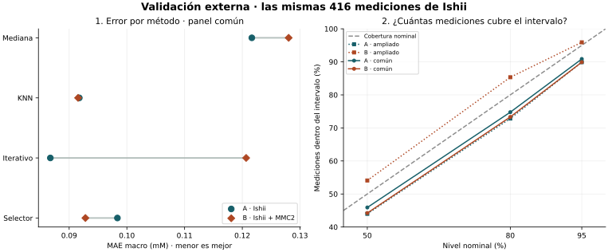

# Bloques 5 y 6 · ¿Elegir el método por metabolito? ¿Confiar en sus intervalos?

**El selector no reemplaza a un método fijo por defecto.** En el panel común, el iterativo fijo obtuvo el menor error con Ishii solo y KNN con Ishii + MMC2. El selector sí obtuvo el menor error en el panel ampliado con MMC2. Los intervalos del iterativo se evaluaron aparte: su porcentaje nominal no garantiza el mismo porcentaje de mediciones cubiertas.



## 5. Seleccionar con el entrenamiento y evaluar con cultivos apartados

Se conservaron 30 cultivos de Ishii, 25 grupos, cinco bloques externos, tres internos y las máscaras del bloque 4. A entrena solo con Ishii; B añade ocho condiciones MMC2 exclusivamente al entrenamiento. El panel común parte de 20 metabolitos; el ampliado ofrece además siete predictores de Ishii, sin inventar valores de MMC2. Los objetivos, las verdades y las máscaras son idénticos. La elegibilidad de las columnas se vuelve a calcular en el Ishii de cada entrenamiento. La mediana opera en mM; KNN e iterativo estandarizan con su propio entrenamiento, sin logaritmos.

En cada bloque externo, panel y escenario se congeló la configuración de cada método previamente elegida por MAE macro en mM en sus tres bloques internos individuales. Se usó esa misma configuración para todos los tipos de máscara, para poder aislar el efecto de elegir **el método**. Sus predicciones internas se compararon dentro de cada metabolito y tipo de máscara. Hacen falta **10 celdas distintas, 5 grupos y 2 bloques internos** con respuesta de los tres métodos. El menor MAE conjunto debe vencer a ambos competidores en al menos dos bloques (empate numérico: ≤ 10⁻¹² mM). Se promedian los errores de distintos patrones de una misma celda antes de puntuarla. Ninguna verdad externa interviene en la elección; internamente la configuración y el método comparten las mismas particiones. Los límites son una regla propuesta, no una prueba de significación.

**Una medición oculta por vez.** MAE macro en mM sobre las mismas 416 de 457 celdas, 16 metabolitos y 25 grupos (menor es mejor). El promedio macro da el mismo peso a cada metabolito; el micro da el mismo peso a cada celda. Se conservan ambos, el sesgo, el RMSE y la cobertura en los resultados detallados.

| Panel | Escenario | Mediana | KNN | Iterativo | Selector |
| --- | --- | --- | --- | --- | --- |
| Común | A | 0,1216 | 0,0918 | 0,0867 | 0,0984 |
| Común | B | 0,1280 | 0,0915 | 0,1207 | 0,0928 |
| Ampliado | A | 0,1216 | 0,0928 | 0,1070 | 0,1024 |
| Ampliado | B | 0,1280 | 0,1166 | 0,2383 | 0,1051 |

- En el panel común A hubo **309 elecciones**, **107 medianas de respaldo** y **41 abstenciones**. En B fueron **341, 75 y 41**, respectivamente. Una mediana que ganó la comparación interna cuenta como elección (47 en A y 17 en B); sigue siendo una estimación general, aun cuando haya ganado. Si falla el método elegido, la política permite una mediana marcada; no se dio ese caso en esta ejecución.
- Frente al iterativo fijo, el selector de A mejoró en 7 de 25 grupos y empeoró en 18. Frente al KNN fijo, el selector de B mejoró en 13 y empeoró en 12. La comparación restringida a elecciones fundadas en **ambos** escenarios reúne solo 250 celdas: el MAE macro del selector es 0,0984 en A y 0,0937 en B. Es un subconjunto distinto; no debe confundirse con el resultado operativo de las 416 celdas.
- Un ejemplo de utilidad y otro de límite: en B común, fumarato eligió KNN en los cinco bloques (MAE externo 0,0188 mM); en A, S7P eligió mediana en los cinco (0,2191 mM). Citrato tuvo como máximo una celda interna emparejada por bloque externo y solo dos celdas externas comparables. No hay base para recomendarle un método.
- En fumarato, el número mediano de donantes disponibles para KNN subió de 18 a 26. En entrenamiento B, succinato fue el predictor con mayor correlación absoluta con fumarato en los 15 subentrenamientos; en A lo fue en tres. Son diagnósticos de soporte y de cambio entre fuentes. Una correlación no demuestra equivalencia fisiológica ni garantiza generalización. Las distancias están en la escala de cada ajuste y no son distancias biológicas absolutas.

**Varios metabolitos ocultos a la vez.** Patrones del panel elegible: 161 predicciones en 71 celdas distintas de 14 grupos; cada celda pesa una vez.

| Panel | Escenario | Mediana | KNN | Iterativo | Selector |
| --- | --- | --- | --- | --- | --- |
| Común | A | 0,0566 | 0,0616 | 0,0697 | 0,0563 |
| Común | B | 0,0620 | 0,0603 | 0,1483 | 0,0612 |
| Ampliado | A | 0,0566 | 0,0571 | 0,0966 | 0,0558 |
| Ampliado | B | 0,0620 | 0,1238 | 0,2980 | 0,0626 |

Con los patrones documentales exactos hubo 38 intentos, pero solo ocho respuestas comparables de cuatro grupos. En todos los casos respondidos el selector recurrió a la mediana por falta de evidencia interna. No procede concluir que ganó en este diseño.

## 6. Comprobar los intervalos del iterativo

En cada combinación de bloque, panel y escenario se reajustó `IterativeImputer(BayesianRidge(), sample_posterior=True)` **200 veces**, con semillas 1100–1299: **4.000 ajustes** en total. Cada sorteo ajusta solo con entrenamiento y completa los perfiles de prueba ya enmascarados. Los componentes de una máscara conjunta se leen de la **misma** imputación. Se conservaron el límite físico cero, la configuración interna y la unidad mM. Se evaluaron también los primeros 30 y 100 sorteos; no se buscó la semilla que diera mejor resultado.

Conviene distinguir tres cantidades: la **SD condicional** es la desviación predictiva de una sola regresión bayesiana con las otras variables fijadas en el perfil determinista completado, antes del límite cero; la **SD entre imputaciones** mide la dispersión de 200 resultados tras reajustar y completar el perfil; el **error externo** compara la media de los sorteos con la medición ocultada. Solo el último usa la verdad. Los intervalos son cuantiles centrales empíricos de las imputaciones, no intervalos de confianza de la media. Se construyeron intervalos para 416 de 457 intentos individuales, el 91,0 %; la cobertura siguiente se calcula sobre esas 416 mediciones.

| Panel | Escenario | Al 50 % | Al 80 % | Al 95 % | Cubiertas al 95 % | Ancho medio 95 % (mM) | Mediana del ancho (mM) |
| --- | --- | --- | --- | --- | --- | --- | --- |
| Común | A | 45,9 % | 74,8 % | 90,9 % | 378/416 | 0,377 | 0,198 |
| Común | B | 44,2 % | 73,3 % | 89,9 % | 374/416 | 0,557 | 0,306 |
| Ampliado | A | 44,0 % | 72,8 % | 89,9 % | 374/416 | 0,425 | 0,187 |
| Ampliado | B | 54,1 % | 85,3 % | 95,9 % | 399/416 | 0,799 | 0,356 |

En el panel ampliado B se alcanzó el 95,9 % global, con un ancho medio de 0,799 mM frente a 0,425 mM sin MMC2. En el panel común añadir MMC2 también ensanchó los intervalos, pero la cobertura bajó. Por eso conviene leer el ancho y la cobertura juntos.

**Panel común · 95 % por metabolito (200 sorteos).** Sesgo positivo significa que se sobreestimó la concentración.

| Metabolito | Celdas | N.º cubiertas A → B | Ancho medio A → B (mM) | Sesgo de la media posterior A → B (mM) |
| --- | --- | --- | --- | --- |
| Fumarato | 23 | 21 → 13 | 0,075 → 0,726 | -0,003 → 0,193 |
| Citrato | 2 | 2 → 1 | 0,022 → 2,493 | 0,005 → 0,858 |
| Adenina | 30 | 27 → 26 | 0,174 → 0,162 | 0,010 → 0,009 |
| ATP | 30 | 27 → 28 | 1,173 → 1,088 | 0,046 → 0,063 |
| PEP | 22 | 19 → 21 | 0,196 → 0,224 | 0,015 → 0,025 |
| S7P | 29 | 26 → 25 | 1,088 → 2,029 | 0,070 → 0,480 |

Fumarato ilustra esa diferencia: con MMC2 el intervalo del panel común fue casi diez veces más ancho y aun así cubrió ocho mediciones menos. En el ampliado B cubrió las 23, pero su ancho medio alcanzó 1,369 mM y el sesgo de la media posterior fue +0,240 mM. Para citrato solo hay dos celdas.

En conjunto, para los patrones simultáneos elegibles del panel común, la cobertura al 95 % fue 90,2 % en A y 90,9 % en B. Se promedian primero los aciertos de los distintos contextos de cada celda; por eso esta proporción no es necesariamente el cociente de dos enteros sobre 71 celdas. Las tablas exponen también el conteo por evento. En los ocultamientos individuales, el 50 % central de las coberturas por grupo fue de 86,7 % a 100,0 % en A y de 85,7 % a 100,0 % en B. Un cultivo puede aportar varias concentraciones; los porcentajes descriptivos no convierten las 416 celdas en muestras experimentales independientes.

**Sensibilidad a los sorteos.** Cobertura al 95 % en el panel común individual. La última comparación usa las semillas 1100–1199 frente a 1200–1299, sin compartir sorteos; «cambio» significa que una medición pasó de estar dentro a fuera del intervalo o viceversa.

| Escenario | 30 sorteos | 100 | 200 | Celdas que cambian entre dos series de 100 | Δ absoluto medio del límite inferior (mM) | Del superior (mM) |
| --- | --- | --- | --- | --- | --- | --- |
| A | 85,6 % | 90,1 % | 90,9 % | 3,6 % | 0,018 | 0,032 |
| B | 85,8 % | 89,4 % | 89,9 % | 1,9 % | 0,024 | 0,048 |

El histórico con sus 30 sorteos mostró 371/416 mediciones cubiertas en A y 361/416 en B. El presente ensayo mantiene los objetivos y grupos, pero usa la selección interna en mM y un orden de perfiles que incluye ocultamientos conjuntos; no es una réplica bit a bit del muestreo histórico. Más sorteos reducen el ruido de cuantiles; no añaden cultivos ni corrigen automáticamente un sesgo. En el control **determinista** hubo 6 advertencias de convergencia en 20 ajustes: una en el ampliado A y las cinco del ampliado B, ninguna en el panel común. En muestreo posterior, 14 configuraciones ejecutaron 50 rondas y 6 ejecutaron 100. La parada temprana no se aplica en este modo. Véanse [IterativeImputer](https://scikit-learn.org/1.8/modules/generated/sklearn.impute.IterativeImputer.html) y [BayesianRidge.predict](https://scikit-learn.org/1.8/modules/generated/sklearn.linear_model.BayesianRidge.html).

## Reproducción y decisión

Desde la raíz, con las [versiones fijadas](requirements.txt):

```bash
python -m ampliacion.selector
python -m ampliacion.incertidumbre --procesos 4
python -m ampliacion.lectura_5_6
python -m unittest discover -s tests
```

Los [resúmenes y la figura](resultados/bloques_5_6) se pueden consultar directamente en el [notebook 02](../02_imputacion_evaluacion.ipynb), sin recalcular. El directorio local `detalle/` contiene las decisiones internas, comparaciones por grupo, abstenciones, apoyo de los predictores y límites por medición. Las huellas de las máscaras y de las opciones se guardan en `selector.json`; las versiones y semillas, en `muestreo.json`.

Conservar los métodos fijos como referencias. El selector del panel ampliado con MMC2 se justifica como hipótesis para evaluar en grupos nuevos. Para informar un intervalo, acompañarlo de su cobertura observada, ancho, sesgo y número de grupos del metabolito. No se recalibraron intervalos con las verdades externas ni se completó ningún faltante real en estos bloques.
