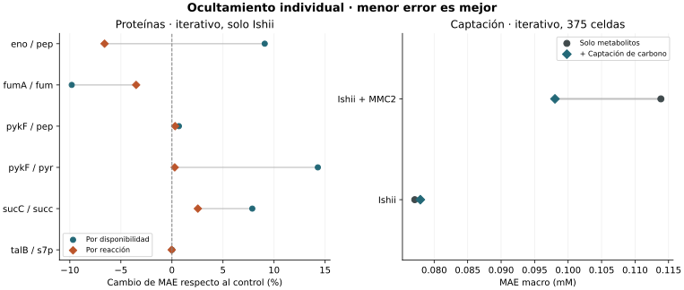

# Bloques 7 y 8 · ¿Ayuda medir una tasa o una proteína?

**La captación aportó información al iterativo entrenado con Ishii + MMC2, pero apenas cambió el resultado al excluir citrato y piruvato. En proteínas, hubo mejoras incluso cuando la variable se eligió sin consultar la red.** Los efectos dependen del metabolito y del método. Se evaluaron concentraciones originales de Ishii ocultadas a propósito; no se completaron huecos reales.



## 7. Tasas del cultivo

Se usaron los 30 cultivos principales de Ishii, en 25 grupos. Se conservaron los cinco bloques externos, sus tres particiones internas y las máscaras individuales y simultáneas de los bloques anteriores. A entrena con Ishii y B añade ocho condiciones de MMC2 únicamente al entrenamiento. El panel de referencia parte de los 20 metabolitos compartidos; solo entran las columnas elegibles en el entrenamiento. El escalador se ajusta sin el grupo de prueba. Los objetivos permanecen en mM y Gerosa conserva la conversión original (µmol/g de peso seco divididos por 2,3 mL/g).

| Variable | Fuente y disponibilidad | ¿Qué representa? ¿Se puede conocer sin el metabolito oculto? |
| --- | --- | --- |
| Captación de carbono | Ishii: glucosa extracelular en `rates`, 27/30. Gerosa: `Physiology`, 8/8; SD por condición | Ishii midió glucosa extracelular con un ensayo enzimático. Gerosa derivó la tasa a partir de HPLC extracelular, biomasa y crecimiento. Multiplicar los mmol de sustrato por sus átomos de C expresa la tasa en mmol C/(g de peso seco·h). Ambas requieren datos de consumo; no se deducen del objetivo intracelular. La tasa de Gerosa es una media de condición. |
| Flujo G6P → 6PG | Ishii: 27/30 tienen el relativo y 24/30 el absoluto. Se compararon ambos en los mismos 24 | Estimación de un modelo con marcaje de aminoácidos proteogénicos y restricciones fisiológicas. El ajuste documentado no usa las concentraciones intracelulares objetivo. El relativo es % de captación; el absoluto equivale al relativo × captación de glucosa / 100. Es información disponible solo si se realizó el análisis de flujo. |
| Dilución | Ishii: 30/30 a 0,2 h⁻¹; cuatro WT adicionales a 0,1–0,7 h⁻¹ | Es una consigna del quimiostato. Es idéntica entre los 30 y no añade información. Los WT de sensibilidad entran solo en entrenamiento cuando el grupo WT no está en prueba. La tasa de crecimiento de Gerosa en lote no se trata como si fuera la dilución de Ishii. |

Los flujos agrupados de MMC2 no se asignaron a una reacción individual sin homologación. Los huecos, los guiones que indican reacción excluida y los ceros publicados se mantienen distintos. La captación y los flujos se añaden como **predictores**; no se divide ninguna concentración por una tasa. [Fuentes, unidades, cobertura y rangos](resultados/bloques_7_8/tasas_documentadas.csv).

**Resultados del iterativo.** MAE medio por metabolito y después entre metabolitos (macro), con idénticas celdas en cada fila. Se conservaron las opciones elegidas por los bloques internos del control anterior. Para la comparación con tasas se volvió a ajustar también el control en el subconjunto pertinente.

| Variable y entrenamiento | Celdas / grupos de prueba | Control (mM) | Con la tasa (mM) |
| --- | --- | --- | --- |
| Captación · Ishii | 375 / 25 | 0,0771 | 0,0779 |
| Captación · Ishii + MMC2 | 375 / 25 | 0,1139 | 0,0980 |
| Flujo relativo · Ishii | 337 / 22 | 0,0766 | 0,0777 |
| Flujo absoluto · Ishii | 337 / 22 | 0,0766 | 0,0770 |
| Dilución · Ishii 30 | 416 / 25 | 0,0867 | 0,0867 |
| Dilución · Ishii + WT adicionales | 429 / 25 | 0,1019 | 0,1023 |

En B, dar al modelo solo el origen Ishii/MMC2 produjo 0,1101 mM; con captación se obtuvo 0,0980 mM. Esta última comparación con el control sin covariable mejoró en **15 de 25 grupos**. Al retirar por turno un grupo de la puntuación, el cambio de MAE macro permaneció entre −0,0191 y −0,0136 mM. Sin embargo, **el 87,1 % de la mejora macro correspondió a citrato (2 celdas) y piruvato (9)**. Si ambos se excluyen del promedio como comprobación de sensibilidad, el control da 0,1002 y el modelo con captación 0,0979 mM. No son conclusiones contradictorias: excluir grupos y excluir metabolitos responden a preguntas distintas. En KNN-B el cambio fue 0,0822 → 0,0815 mM; la mediana no depende de esta covariable.

Con patrones simultáneos aprendidos solo en los entrenamientos, el iterativo-B pasó de 0,1461 a 0,1208 mM al añadir captación, sobre 145 eventos que corresponden a **64 celdas de 13 grupos**. Una celda puede participar en más de un patrón, pero su error pesa una vez. El análisis documental exacto tiene pocos casos. Los resultados no justifican recomendar una tasa para cualquier cultivo. [Por metabolito, con sesgo](resultados/bloques_7_8/captacion_por_metabolito.csv) · [Tres métodos y tres clases de máscara](resultados/bloques_7_8/tasas_resultados.csv).

## 8. Una proteína por vez

En los 30 cultivos hay **67 proteínas catalogadas**, **61 con alguna medición**, y **26 cultivos con al menos una proteína**. La hoja `proteins` contiene abundancias absolutas por LC-MS/MS en **mg de proteína/g de peso seco**, separadas de las concentraciones de metabolitos. Cada abundancia y su CV se cotejaron contra SQLite y la celda original: hay 1.691 abundancias y 1.633 CV entre las corridas de la cohorte. No se convirtieron ausencias ni genes perturbados en abundancia cero.

RF03 es un cultivo, medido en las series proteicas 2–6. Lo confirman las tablas S2 y S7B y los identificadores del libro. Se usó la mediana de las abundancias disponibles de cada proteína en esas cinco corridas, se guardaron sus CV, valores y dispersión, y se repitió el contraste usando por separado cada corrida. No se atribuyeron corridas de RF03 a otros WT. KO05x tiene columnas vacías; RF04–06 no tienen mediciones proteicas enlazables. Las cuatro condiciones WT adicionales no entran en el bloque 8.

Por cada par propuesto y bloque externo, se compararon **tres alternativas sobre las mismas filas**: solo metabolitos; una proteína elegida por disponibilidad; una proteína elegida por reacción. La elección por disponibilidad minimiza el número de cultivos **del entrenamiento** con disponibilidad diferente respecto a la proteína propuesta; exige diez coincidencias y variación y desempata mediante una semilla fija, sin consultar las concentraciones objetivo, el error ni la red. La proteína debe estar medida al predecir. El entrenamiento y la prueba usan la intersección de disponibilidad: **una misma columna adicional por modelo**, incluso cuando una de las dos proteínas está medida en más cultivos. La selección por red se fijó antes de comparar errores: Eno/PEP, PykF/PEP o piruvato, TalB/S7P, FumA/fumarato y SucC/succinato.

La reacción y su compuesto se cotejaron en MMC4, y la asociación funcional se contrastó con las anotaciones de Ishii y K‑12. Eso no verifica por secuenciación la cepa BW25113, la actividad de una isoenzima ni la cantidad de complejo activo. La selección *sin red* tampoco significa que la proteína sea biológicamente ajena: para succinato se eligió **SdhB** por disponibilidad en los cinco bloques y, al revisar después, se encontró asociada a succinato en SUCDH3. [Identidades, reacción y UniProt](resultados/bloques_7_8/pares_de_red.csv) · [Controles elegidos y coincidencias documentadas](resultados/bloques_7_8/controles_sin_red.csv).

Las opciones de KNN e iterativo se volvieron a escoger **solo para el control sin proteína**, con las particiones internas restringidas a sus cultivos, y se congelaron para las otras dos alternativas. El criterio fue MAE macro en mM; no se eligió el método mirando el resultado externo. El escalado usa únicamente entrenamiento. La proteína no sustituye el mínimo de dos metabolitos observados, ni permite usar en KNN un donante que se parezca únicamente por su proteína. La mediana usa los mismos cultivos y por construcción no cambia.

**Una medición oculta por vez: MAE del iterativo en mM.** «Por reacción» usa la proteína indicada en la primera columna. Cada fila representa un experimento; no se suman las dos evaluaciones de PEP ni los distintos patrones de una misma medición.

| Proteína propuesta → objetivo | Celdas / grupos | Solo metabolitos | Por disponibilidad | Por reacción |
| --- | --- | --- | --- | --- |
| Eno → PEP | 20 / 19 | 0,05481 | 0,05979 | 0,05119 |
| PykF → PEP | 21 / 20 | 0,05324 | 0,05361 | 0,05341 |
| PykF → piruvato | 14 / 14 | 0,09110 | 0,10412 | 0,09135 |
| TalB → S7P | 25 / 24 | 0,18440 | 0,18443 | 0,18436 |
| FumA → fumarato | 22 / 21 | 0,02356 | 0,02125 | 0,02273 |
| SucC → succinato | 24 / 24 | 0,01998 | 0,02155 | 0,02049 |

- **PEP:** Eno mejoró el iterativo en 12 de 19 grupos. Al puntuar sin un grupo por turno, la diferencia frente al control siempre favoreció a Eno (−0,00460 a −0,00208 mM). En los mismos casos, la mediana de entrenamiento dio **0,04672 mM**, menor que el iterativo con Eno. Una mejora de un método no implica que sea el mejor método.
- **Fumarato:** la proteína escogida por disponibilidad, **AdhE**, redujo el MAE del iterativo de 0,02356 a 0,02125 mM. También bajó su RMSE de 0,03110 a 0,02684 mM y el sesgo pasó de −0,00414 a −0,00299 mM. FumA lo redujo a 0,02273 mM. En KNN el orden fue distinto: control 0,01816, AdhE 0,01777, FumA 0,01750 mM. No es una prueba de causalidad de AdhE.
- **S7P, piruvato y succinato:** la diferencia del iterativo con TalB fue de aproximadamente −0,00004 mM; PykF/piruvato y SucC/succinato no mejoraron al control. En el patrón documental exacto las alternativas proteicas solo aportan entre cero y tres celdas por par. Cuando faltan casos no se asigna ganador.
- **Sensibilidad técnica:** al reemplazar la mediana de RF03 por cada una de sus cinco corridas, el cambio de MAE del iterativo con Eno/PEP estuvo entre -0,00362 y -0,00184 mM; con AdhE/fumarato entre -0,00231 y -0,00219 mM. En ambos casos se conserva el sentido del resultado.

[Comparación de los tres métodos](resultados/bloques_7_8/proteinas_resultados.csv) · [MAE, RMSE y sesgo](resultados/bloques_7_8/proteinas_errores.csv) · [Estabilidad entre grupos](resultados/bloques_7_8/estabilidad_individual.csv).

**Intervalos predictivos del iterativo.** Para cada entrenamiento, proteína y configuración distinguibles se hicieron **100 reajustes independientes**, semillas 1100–1199 (6.400 en total). Se compararon cuantiles centrales al 50, 80 y 95 %; el prefijo de 30 sirve como sensibilidad. No se calculan intervalos para la mediana o KNN. En esta tabla, cada casilla muestra **mediciones cubiertas / mediciones con intervalo · ancho medio en mM** para el nivel nominal del 95 %.

| Objetivo / proteína propuesta | Solo metabolitos | Por disponibilidad | Por reacción |
| --- | --- | --- | --- |
| Eno → PEP | 17/20 · 0,193 | 16/20 · 0,186 | 16/20 · 0,186 |
| PykF → PEP | 19/21 · 0,200 | 16/21 · 0,190 | 16/21 · 0,185 |
| PykF → piruvato | 12/14 · 0,284 | 11/14 · 0,304 | 12/14 · 0,294 |
| TalB → S7P | 23/25 · 0,817 | 23/25 · 0,852 | 24/25 · 0,852 |
| FumA → fumarato | 20/22 · 0,076 | 20/22 · 0,076 | 19/22 · 0,076 |
| SucC → succinato | 20/24 · 0,075 | 21/24 · 0,076 | 21/24 · 0,077 |

Para fumarato, el control cubrió 20 de 22 mediciones; AdhE cubrió 20 y FumA 19. En los seis pares, pasar de 30 a 100 sorteos cambió el número de mediciones cubiertas al 95 % hasta en **4** por brazo. Un sorteo adicional no aporta otro cultivo. Con 14–25 celdas comparables por par es preferible mostrar los conteos y los anchos, no afirmar que un intervalo está calibrado por aproximarse al 95 %. La comparación determinista registró una advertencia de convergencia en el brazo por disponibilidad, ninguna en el control ni en el brazo por reacción (30 ajustes por brazo). El muestreo posterior ejecuta el número de rondas fijado, sin parada anticipada. [Resultados por nivel e intervalo](resultados/bloques_7_8/intervalos_proteinas.csv).

**Decisión:** conservar el control sin proteína como referencia. Eno/PEP y AdhE/fumarato son hipótesis para nuevos cultivos. La comparación prueba el aporte de una columna **manteniendo el número de cultivos**, no el efecto de añadir muestras, que se evaluó en el [bloque 3](BLOQUES_1_4.md). Un solo control por disponibilidad y par no permite concluir que cualquier proteína funcione ni que sea necesario conocer de antemano la reacción. No se ajustó un panel de muchas proteínas ni se modificaron mediciones originales.

## Reproducción

Desde la raíz del repositorio, en el entorno del proyecto:

```bash
python -m pip install -r ampliacion/requirements.txt
python -m ampliacion.bloques_7_8 --procesos 4
python -m unittest discover -s tests
```

El número de procesos cambia el tiempo, no el resultado. El [notebook 01](../01_auditoria_preparacion.ipynb) muestra la procedencia; el [notebook 02](../02_imputacion_evaluacion.ipynb) muestra los errores y la cobertura sin repetir el muestreo. En `ampliacion/resultados/bloques_7_8/detalle/` se generan las decisiones internas, predicciones, abstenciones, CV, resultados por grupo y sorteos por semilla. [Versiones y huellas de las fuentes](resultados/bloques_7_8/ejecucion.json).

Fuentes experimentales: [Ishii et al., Science (2007)](https://doi.org/10.1126/science.1132067), [métodos, PDF pp. 4–7 y 12–13; tablas S2 y S7B](../sources/Ishii_methods.pdf); [Gerosa et al., Cell Systems (2015)](https://doi.org/10.1016/j.cels.2015.09.008), [métodos, PDF pp. 8–9](../sources/Gerosa_methods.pdf). Para comprobar las funciones K‑12: [Eno](https://www.uniprot.org/uniprotkb/P0A6P9/entry), [PykF](https://www.uniprot.org/uniprotkb/P0AD61/entry), [TalB](https://www.uniprot.org/uniprotkb/P0A870/entry), [FumA](https://www.uniprot.org/uniprotkb/P0AC33/entry) y [SucC](https://www.uniprot.org/uniprotkb/P0A836/entry).
