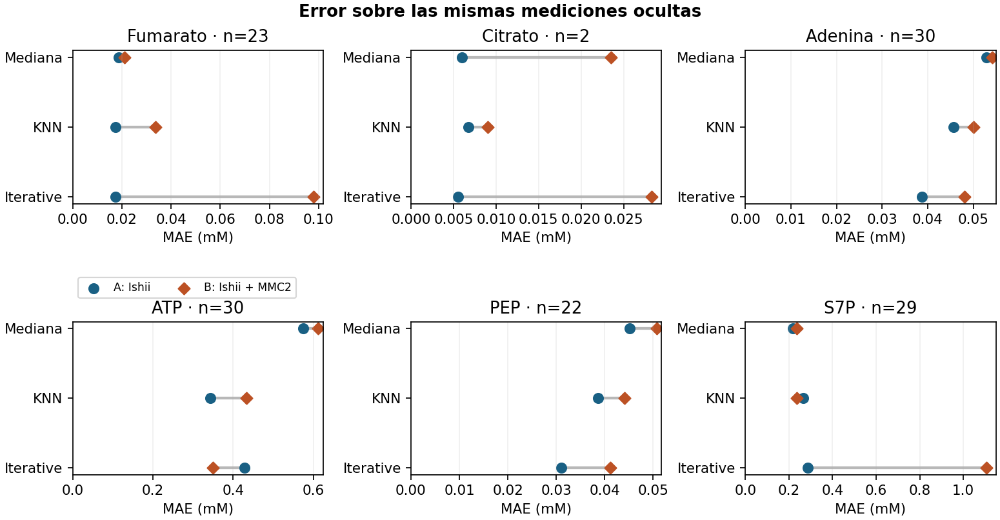

# ¿Cuándo ayuda añadir metabolitos y datos de MMC2?

**Recomendación.** Trabajar en mM, mantener como cohorte principal los 30 cultivos a la misma dilución y conservar el panel común como referencia operativa. Los siete predictores nuevos son mediciones legítimas de Ishii: incluirlos todos a la vez no mejoró el MAE macro con opciones fijas. Tampoco se justifica añadir las ocho condiciones de MMC2 por defecto. Hay excepciones por método y objetivo; en varias intervienen muy pocos grupos.

El 20 de noviembre de 2026, la comparación entre el commit auditado [3c6ab55](https://github.com/pedro1ani/Ipre/commit/3c6ab55a2bfcfc819b475916d530384e9cb78fb2) y `main` dio 0 commits de diferencia. El estudio reutiliza los valores y bloques externos e internos de ese commit. Se reprodujeron sus predicciones con las opciones archivadas (diferencia máxima inferior a 10⁻¹³ mM), aunque la versión de Python y las bibliotecas del presente análisis son distintas. Se registran ambas ejecuciones por separado.

## 1. Qué se incorpora a la matriz

El inventario contiene **579 filas analíticas intracelulares** de Ishii, no 579 identidades independientes: 149 filas tienen al menos diez observaciones entre los 30 cultivos y 383 tienen menos de cinco. Revisamos los 20 emparejamientos nominales aceptados y conservamos sus filas y protocolos. Por ejemplo, las dos filas de citrato no se suman: la señal de aniones (133) no tiene mediciones y la de nucleótidos (523) sí. Entre estudios, una misma identidad nominal no garantiza que dos técnicas midan sin sesgo.

| Señal adicional de Ishii (protocolo aniones) | Fila de la hoja metabolites | Medidas / 30 | Por qué no se toma un valor de MMC2 |
| --- | ---: | ---: | --- |
| Glucosa-6-fosfato | 174 | 30 | Ishii no especifica D; MMC2 sí. |
| Fructosa-6-fosfato | 173 | 28 | Misma limitación estereoquímica. |
| Ribulosa-5-fosfato | 164 | 29 | MMC2 identifica D-ribulosa-5-fosfato. |
| Malato | 53 | 24 | MMC2 identifica L-malato. |
| 3-fosfoglicerato | 124 | 25 | MMC2 cuantifica juntos 2PG + 3PG. |
| Glucosa-1-fosfato | 172 | 28 | No hay una contraparte inequívoca; galactosa-1-fosfato es otra entidad. |
| Ribosa-5-fosfato | 165 | 18 | MMC2 especifica alfa-D; se mantiene separada también de ribulosa-5-fosfato. |

Se eligieron las cuatro señales solicitadas y tres alternativas identificables del mismo protocolo antes de evaluar sus errores. No se realizó una búsqueda entre las 149 señales sobre sus resultados externos. Las 20 variables históricas siguen siendo posibles objetivos; las siete nuevas son **solo predictores**. No se ha validado aún imputar estas siete como objetivos. Para MMC2 quedan 56 posiciones estructuralmente vacías (8 × 7). KNN trabaja con el solapamiento medido; Iterative puede estimarlas *internamente* al ajustar regresiones. Esas extrapolaciones no son observaciones de Gerosa ni se exportan como tales.

La matriz documental tiene 42 filas × 27 columnas: 30 cultivos principales, cuatro WT adicionales y ocho auxiliares. La convención de una fila por muestra ya aparece en [normalizar.py del primer commit](https://github.com/pedro1ani/Ipre/blob/8dce3d5c2/normalizar.py). El historial constata la orientación; no documenta la intención original. Hoy tiene una razón concreta: retirar un grupo retira cultivos completos, KNN compara cultivos por sus perfiles y las regresiones predicen una columna mediante otras. Las réplicas del mismo grupo no se convierten en grupos independientes. El [diccionario](resultados/diccionario.csv) distingue identidad, disponibilidad propia y disponibilidad de una posible contraparte; la [traza larga](resultados/trazabilidad.csv) vincula cada valor o ausencia de origen con archivo, hoja, celda, unidad, división y SD cuando existe.

## 2. Escala, selección y evaluación

Ishii ya está en mM. En Gerosa, **(µmol/g de peso seco) ÷ (2,3 mL/g de peso seco) = µmol/mL = mM**. Se verificó el factor en la hoja *Conversion Factors*, la conversión de concentraciones y SD contra los Excel, y las 20 referencias bajo glucosa: medidas, finitas, positivas, con SD documentada. No se conoce la incertidumbre del factor de volumen; las SD de las mediciones no la incluyen.

Para un metabolito con referencia fija positiva `r`, media de entrenamiento `μ` y desviación `σ > 0`, el promedio de `x/r` es `μ/r` y su desviación es `σ/r`. Por tanto, **(x/r − μ/r)/(σ/r) = (x − μ)/σ**. Se conserva el mismo patrón de faltantes y el límite de concentración cero se transforma de la misma forma. La mediana también conmuta con la división positiva. Se excluyen columnas sin variación. Con las máscaras, columnas y opciones históricas fijas, el máximo cambio en Z fue **1,33 × 10⁻¹⁵**, y en las 2.496 predicciones comparables, **1,02 × 10⁻¹⁴ mM**; no cambió ninguna abstención. [Comprobación por método y escenario](resultados/equivalencia_predicciones.csv).

Cinco bloques externos por grupo de perturbación, tres internos, 25 grupos y 457 mediciones originales ocultables. Cada consulta oculta el objetivo en su propia copia y conserva los faltantes naturales; no simula patrones multivariables nuevos ni valida en series instrumentales independientes. La elegibilidad, el escalador, los vecinos y las regresiones ven solo el entrenamiento. Las dos opciones de Iterative y cuatro de KNN son las históricas; se eligen por **MAE en mM macro** sobre las mismas celdas internas de todas las opciones; un empate favorece la primera. La mediana no se ajusta por búsqueda. El registro incluye parámetros, semilla, versiones, límites y avisos de convergencia.

El indicador principal es el **MAE en mM por metabolito**. Como complemento, cada error absoluto se divide por el IQR del entrenamiento **Ishii del bloque externo**, incluso en B; si no es positivo, ese cociente no contribuye y se informa su recuento. RMSE destaca errores grandes; sesgo es *predicción menos observación*. El macro promedia los indicadores por metabolito con respuesta; el micro da igual peso a cada celda. Por ejemplo, en el panel ampliado el citrato aporta 1/16 del MAE macro pero solo 2/416 del micro; ATP aporta 1/16 y 30/416, respectivamente. Ningún promedio sustituye la tabla por analito.

| Decisión aislada | Qué se mantuvo fijo | Resultado sobre mediciones emparejadas |
| --- | --- | --- |
| Cociente → mM | Columnas, bloques y opciones archivadas | Equivalencia numérica para los tres métodos. |
| Elegir por MAE/R → elegir por MAE mM | Entrada en mM, panel común y cuadrícula | Cambió la opción en 12 de 20 combinaciones bloque × escenario × método ajustable. En KNN-B el MAE macro externo pasó de 0,0853 a 0,0915 mM. Una métrica más interpretable no garantiza menor error externo. |
| Añadir siete predictores | Mismos objetivos, muestras y opciones por bloque del panel común | MAE macro KNN A: 0,0918 → 0,0935; B: 0,0915 → 0,1100. Iterative A: 0,0867 → 0,1062; B: 0,1207 → 0,2384 mM. |
| Añadir las ocho filas de MMC2 | Panel ampliado y las opciones elegidas en A, también en B | KNN: 0,0928 → 0,1173; Iterative: 0,1070 → 0,2589 mM. El deterioro no se explica solo por haber reajustado los parámetros de B. |

**Qué aporta cada señal por separado.** Añadimos cada predictor al panel común de uno en uno, manteniendo los mismos objetivos elegibles, las opciones elegidas en el panel común y las 416 celdas de comparación. Las siete señales resultaron elegibles en los cinco bloques externos. El 3-fosfoglicerato fue el único que redujo el MAE macro en los cuatro pares método/escenario: KNN −0,0006 mM en A y −0,0041 en B; Iterative −0,0017 y −0,0133. Glucosa-6-fosfato aumentó el MAE de Iterative-B en 0,0862 mM; ribulosa-5-fosfato lo aumentó en ambos métodos y escenarios. F6P, malato y G1P tuvieron efectos de distinto signo según el ajuste. Estos contrastes no son aditivos y comparten pruebas: **3PG merece una confirmación independiente**, no una incorporación decidida tras ver la validación. [Siete contrastes individuales](resultados/predictor_individual.csv) · [Efecto por objetivo](resultados/predictor_por_metabolito.csv).

La elección histórica pondera cada error por el inverso de la referencia: para adenina es 0,01354 mM y para ATP 3,44914 mM. Con KNN-A, 0,0456 mM en adenina equivale a 3,37 unidades Gerosa; 0,3428 mM en ATP, a 0,099. Es útil conservar ambos números, pero contestan preguntas diferentes.

## 3. Efecto de MMC2 con el panel ampliado

**416 de 457 celdas (91,0 %) respondidas por los seis ajustes, en 25 grupos**; los 41 huecos de evaluación sin respuesta se debieron a la elegibilidad del objetivo. El MAE macro en mM fue 0,1216 → 0,1280 (Mediana), 0,0928 → 0,1166 (KNN) y 0,1070 → 0,2383 (Iterative). Para Iterative el micro pasó de 0,1176 a 0,2318 y su RMSE micro de 0,3567 a 1,0933 mM. La cobertura idéntica permite comparar error directamente.

| Objetivo | Celdas / grupos evaluados | MAE KNN A → B (mM) | MAE Iterative A → B (mM) | Interpretación |
| --- | ---: | ---: | ---: | --- |
| Fumarato | 23 / 21 | 0,0173 → 0,0338 | 0,0175 → 0,0978 | Iterative empeora en 18 de 21 grupos; el sesgo cambia de −0,0081 a +0,0465 mM. |
| Citrato | 2 / 2 | 0,0068 → 0,0090 | 0,0055 → 0,0283 | Solo se pudieron evaluar dos de doce mediciones. No elegir método ni completar huecos a partir de esos dos casos. |
| Adenina | 30 / 25 | 0,0456 → 0,0501 | 0,0386 → 0,0480 | A da menor MAE para ambos métodos; Iterative-B empeora en 16 grupos. |
| ATP | 30 / 25 | 0,3428 → 0,4330 | 0,4287 → 0,3493 | El iterativo mejora el promedio y reduce el sesgo de +0,1476 a +0,0657; por grupos mejora en 12, empeora en 12 y empata en 1. |
| PEP | 22 / 20 | 0,0386 → 0,0441 | 0,0310 → 0,0412 | B reduce el sesgo del iterativo de +0,0059 a +0,0007, pero aumenta el error absoluto. |
| S7P | 29 / 24 | 0,2643 → 0,2366 | 0,2859 → 1,1050 | B mejora KNN en 13/24 grupos. En Iterative-B el sesgo es +0,8780 y el RMSE 3,273 mM: KO05x tenía 2,690 mM y predijo 19,655. |

[Mediana y todas las métricas por analito](resultados/por_metabolito.csv) · [Cambios dentro de cada grupo](resultados/aporte_por_grupo.csv) · [Errores por bloque](resultados/por_bloque.csv). Los promedios de grupo ponderan sus cultivos internamente; no se tratan múltiples lecturas de un mismo grupo como replicación independiente.

**Similitud fisiológica.** Los cultivos de Ishii están en quimiostato limitado por glucosa; Gerosa mide WT BW25113 en lote exponencial, en ocho fuentes de carbono, con LC-MS/MS frente a los protocolos CE-MS de Ishii. Compartir sustrato no iguala el crecimiento: en Gerosa glucosa tiene μ = 0,65 h⁻¹; galactosa (0,18) es la más cercana a D = 0,2 de Ishii. Con las mismas opciones de A, añadir únicamente glucosa dio 0,0999 mM de MAE macro para Iterative, frente a 0,1070 en A; añadir solo galactosa dio 0,1196 y añadir las ocho, 0,2589. Para KNN fueron 0,0909, 0,0928 (A), 0,0916 y 0,1173. Es un contraste exploratorio con una condición por sustrato, no una regla de selección. Técnica, régimen, tasa y composición no pueden aislarse causalmente aquí. La [tabla de contrastes](resultados/contrastes.csv) separa WT y KO; los cinco WT representan **un** grupo de prueba.

## 4. Decisiones prácticas y límites

- **Elegibilidad.** Mantenemos diez mediciones, cinco grupos, dos valores distintos y dos predictores con al menos cinco pares medidos. En el panel ampliado eso deja 22–23 variables en los cinco entrenamientos externos y 20–22 en los quince internos. Con mínimo 8 son 24 y 21–23; con mínimo 12, 21–22 y 16–20. A 8 se evalúan 437 celdas, a 10 se evalúan 416 y a 12, 404. A 8 el 2-oxoglutarato y el citrato pasan el umbral en cinco bloques, frente a cero y dos con mínimo 10. KNN-A aparenta mejorar a 8 en el promedio disponible, pero en las mismas celdas su MAE macro aumenta 0,0007 mM. No bajamos el umbral solo por cobertura. El [detalle de elegibilidad](resultados/elegibilidad_bloques.csv) muestra además el soporte que parecería ganarse si se contaran auxiliares sin exigir soporte Ishii.
- **Cuatro WT adicionales.** GR01–GR04 tienen D = 0,1; 0,4; 0,5 y 0,7 h⁻¹. Solo se añadieron al entrenamiento cuando el grupo WT estaba ya dentro; nunca se probaron como cultivos independientes. En A el MAE macro de KNN pasa de 0,0928 a 0,0896 y el de Iterative de 0,1070 a 0,0935; en B el de Iterative sube de 0,2383 a 0,2913. Mantener 30 para el resultado principal y conservar las otras cuatro como sensibilidad evita mezclar dilución con perturbación.
- **Valores extremos.** En los cinco entrenamientos externos hubo variables con valores fuera de las cercas de 1,5 IQR cuya retirada hipotética reducía la SD al menos 25 %. Para ribulosa-5-fosfato la caída llegó a 88 %. Se conservaron todas las observaciones y se probó mediana/IQR como escala, con opciones fijas: KNN-A empeoró de 0,0928 a 0,0995; Iterative-B bajó de 0,2383 a 0,1856 mM, aún peor que A. No se adopta escalamiento robusto general. [Diagnóstico de entrenamiento](resultados/extremos.csv).
- **Convergencia y aplicación.** Iterative alcanzó el límite sin converger en 1/5 bloques externos de A y 5/5 de B; el ajuste final B también agotó las 100 rondas. La mediana se etiqueta como sustitución general. KNN exige dos predictores medidos y tres donantes con distancia finita; Iterative exige dos predictores medidos. Las 600 posiciones de los 20 objetivos en Ishii contienen 457 observaciones y 143 huecos. Tras exigir diez predicciones externas en tres bloques, cada método/escenario estima **36** de esos huecos y deja **107** pendientes. Se preservaron las 457 mediciones originales. Los 36 resultados finales de Iterative-B llevan advertencia de no convergencia; **no se recomiendan para completar la base de trabajo**. El umbral de cobertura acredita soporte mínimo, no exactitud. Los descriptivos en mM distinguen observaciones, estimaciones y huecos comunes; el CV se deja vacío si la media no es positiva o hay menos de dos valores.

La comparación externa sigue procediendo de un único estudio pequeño. Usar estos mismos resultados para elegir un método por metabolito produciría una estimación optimista de esa nueva regla; requeriría una validación aparte. Los intervalos posteriores del estudio anterior se mantienen como histórico y no se atribuyen al panel ampliado.

Fuentes: [Ishii et al., Science (2007)](https://doi.org/10.1126/science.1132067), [Gerosa et al., Cell Systems (2015)](https://doi.org/10.1016/j.cels.2015.09.008), [suplementos y libros originales](../sources), [versiones y huellas](resultados/ejecucion.json).
