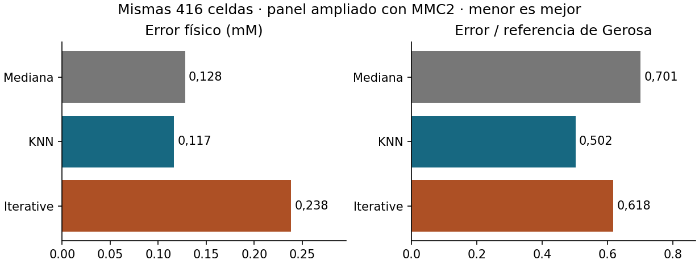

# Qué error conviene medir y qué aportan las tasas fisiológicas

**Decisión para el proyecto:** mantener las concentraciones en mM, estandarizar cada metabolito solo con el entrenamiento para KNN e Iterative y evaluar principalmente el **MAE en mM por metabolito**. La mediana se calcula en mM. La referencia en glucosa de Gerosa queda como indicador histórico. La captación merece estudiarse como predictor auxiliar cuando se conoce en el cultivo que se desea imputar; esta revisión no justifica dividir todos los metabolitos por una tasa.

## 4. Métricas: el denominador puede cambiar el veredicto

La comprobación más directa usa el panel ampliado del estudio anterior: **las mismas 416 mediciones de Ishii, 16 metabolitos con respuesta, 25 grupos, entrenamiento B (Ishii + MMC2)**. En las tres filas de cada columna se puntuaron exactamente las mismas celdas. Al pasar de una columna a la siguiente no se volvió a entrenar ni se cambió una predicción.

| Método | MAE macro (mM) | MAE relativo a Gerosa (macro, sin unidad) | RMSE micro (mM) | Sesgo micro (mM) |
| --- | ---: | ---: | ---: | ---: |
| Mediana | 0,1280 | 0,7009 | 0,2949 | +0,0287 |
| KNN | 0,1166 | 0,5020 | 0,3015 | +0,0415 |
| Iterative | 0,2383 | 0,6177 | 1,0933 | +0,1355 |

El iterativo tiene mayor error en concentración que la mediana, pero parece mejor si se divide cada error por Gerosa. **Dentro de un mismo metabolito**, dividir por una constante positiva conserva el orden de los métodos. **Al promediar metabolitos**, un mismo error en mM pesa en proporción al inverso de su referencia. La referencia de adenina es 0,01354 mM y la de ATP 3,44914 mM: el mismo error en mM pesa unas 255 veces más en adenina que en ATP. Tampoco son escalas representativas de todos los cultivos Ishii. La mediana observada de adenina en Ishii es 6,82 veces su referencia; la de S7P, 0,050 veces. Esas medianas del conjunto completo son descriptivas y no intervienen en el ajuste.

En Iterative-B, S7P aporta **29,0 %** de la suma de los MAE en mM, pero solo **3,1 %** al expresarlos respecto a Gerosa. En adenina ocurre lo contrario: **1,3 % → 35,9 %**. El indicador histórico responde a la pregunta «¿qué fracción de la concentración de Gerosa representa mi error?», distinta de «¿en cuántos mM me equivoqué en Ishii?». [Errores por metabolito](resultados/revision/error_panel_ampliado.csv); el desglose de los pesos se genera como `pesos_Gerosa.csv`.

**Conjunto reducido.** Para cada celda, el error firmado es la concentración predicha menos la observada. Solo las mediciones originales ocultas son verdades. El IQR es la diferencia entre los percentiles 75 y 25.

| Indicador | Cómo se calcula | Qué permite distinguir |
| --- | --- | --- |
| **MAE (mM), principal** | Promedio del valor absoluto del error. | Tamaño del error en la unidad del experimento; se informa por metabolito antes del global. |
| **RMSE (mM)** | Raíz del promedio de los errores al cuadrado. | Da más peso a errores grandes. En S7P, Iterative-B tiene MAE 1,105 y RMSE 3,273 mM. |
| **Error absoluto / IQR de Ishii** | Se divide cada error absoluto por el IQR del metabolito en los cultivos Ishii del entrenamiento externo; luego se promedia. | Sitúa el error en la variabilidad observada de Ishii. Se congela el mismo IQR para todas las alternativas del bloque, antes de restringir por disponibilidad de tasas. Si es cero o no se estima, se omite solo este cociente y se cuenta cuántos aportan. No hubo IQR inválidos entre las 416 celdas comparables de la comparación de escala. Un IQR positivo muy pequeño también requiere cautela. |
| **Sesgo (mM)** | Promedio del error firmado. | Positivo: sobreestima. Negativo: subestima. Un sesgo cercano a cero puede ocultar errores grandes de ambos signos. |

**Estabilidad y cobertura** acompañan estos cuatro indicadores. Se calcula el MAE dentro de cada grupo de perturbación y se presentan su mediana y cuartiles entre grupos, sin dar más peso al grupo WT por tener más cultivos. Para comparar una alternativa con su control se cuentan los grupos que mejoran, empeoran o empatan. Con menos de tres grupos no se informa un rango intercuartílico entre grupos. Los cuartiles describen heterogeneidad, no constituyen un intervalo de confianza. Por ejemplo, en S7P el MAE de Iterative-B por grupo tiene mediana 0,233 y cuartiles 0,085–0,761 mM (24 grupos); su MAE combinado es 1,105 mM. Las cinco particiones son una única validación agrupada; las condiciones de MMC2 nunca se usan como prueba.

El **macro** da el mismo peso a cada metabolito que tiene predicción; el **micro**, a cada celda. Dos celdas de citrato pueden pesar tanto como treinta de ATP en el macro. Se muestran intentos, respuestas, celdas comunes, grupos y número de IQR válidos. Evitamos MAPE porque dividir por una observación nula o pequeña puede dominar el promedio; MSE duplica la información de RMSE y pierde los mM; R² es poco informativo con dos observaciones o poca variación. El MAE relativo a Gerosa se conserva para reproducir el estudio histórico, sin volver a utilizarlo como criterio principal de selección. En el panel común, elegir por MAE en mM en vez de MAE/Gerosa cambió la opción interna en 12 de las 20 combinaciones de bloque, escenario y método ajustable ([búsqueda interna](resultados/busqueda.csv)).

## 5. Normalización y fisiología

**Qué se verificó antes de probar las tasas.** Los cruces se hacen por identificador explícito de cultivo o condición, no por la posición de la columna. Por ejemplo, RF05 está en AK en metabolitos, AI en tasas y AJ en flujos relativos. Una celda vacía, una reacción excluida del modelo (guion) y un cero publicado quedan diferenciados. KO05x y KO05 son cultivos distintos de la misma perturbación; KO05x no tiene fila propia en la tabla SQLite de muestras, pero su ID y régimen se verifican en el Excel. Nunca se le atribuyó la tasa de KO05.

| Magnitud | Disponibilidad y unidad | Relación con la concentración |
| --- | --- | --- |
| Dilución de Ishii | Los **30/30** cultivos principales tienen D = 0,2 h⁻¹. Cuatro WT adicionales: 0,1; 0,4; 0,5 y 0,7 h⁻¹. | Es un ajuste del quimiostato. Una constante no distingue los 30 perfiles. En MMC2 hay crecimiento medido en lote (μ = 0,18–0,65 h⁻¹); no se inventó una dilución equivalente. |
| Captación de glucosa de Ishii | **27/30** y los cuatro WT adicionales; 2,67–4,49 mmol de glucosa/(g de peso seco·h) en la cohorte principal. Faltan KO05x, RF02 y RF04. | Tasa específica de consumo; no es glucosa intracelular. La hoja *rates* también tiene O₂, CO₂ y producción de seis compuestos: se inventariaron, sin seleccionar entre ellos por su error. |
| Flujos de Ishii | 43 filas de flujo relativo (% de captación de glucosa), siete coeficientes de intercambio adimensionales y 43 filas de flujo absoluto en *final fluxes*, con cobertura desigual. | Se ensayó **una reacción identificada antes de comparar errores**, G6P → 6PG, como descriptor de la rama oxidativa. Hay 27/30 valores relativos y 24/30 absolutos publicados (0–98 % y 0–2,6754 mmol/(g de peso seco·h)). Para comparar ambas formas se usan los mismos 24 cultivos. Donde ambas existen, el flujo absoluto coincide con el porcentaje por la captación dividido por 100: no son réplicas independientes. Los flujos se estimaron por marcaje posterior al muestreo de metabolitos, no en la misma alícuota. |
| Fisiología y flujos de MMC2 | En **8/8** condiciones hay μ y captación del sustrato con SD. Hay 35 filas de flujos/módulos con unidades de tasa; no se cuenta de nuevo la fila de crecimiento. | Se verificaron las tasas en *Physiology*, no se hizo corresponder automáticamente la reacción Ishii con un módulo compuesto de MMC2. Para comparar captaciones se usaron mmol de **carbono**/(g de peso seco·h): captación molar × número de C del sustrato. Eso armoniza la unidad; no iguala sustratos, energía, régimen ni técnicas. |

El [notebook de preparación](../01_auditoria_preparacion.ipynb) genera `condiciones.csv`, `inventario.csv` y `fuentes_fisiologicas.csv.gz`, con las unidades y celdas de procedencia. Las SD de MMC2 son información de procedencia y no se propagaron como incertidumbre del modelo.

**Qué se comparó.** Escenario A: Ishii; B: Ishii con ocho condiciones auxiliares MMC2. Los ensayos de fisiología emplean las 20 correspondencias documentales como panel candidato, con la elegibilidad recalculada en el entrenamiento de cada alternativa. Usan las mismas opciones de KNN/Iterative elegidas por MAE macro en mM en los tres bloques internos del panel común; no se volvieron a elegir mirando el resultado externo. Una sensibilidad cambia un factor a la vez. Cuando faltan tasas, tanto el modelo con la tasa como su control usan exactamente las mismas filas de entrenamiento y de prueba. Una tasa sola no cuenta como metabolito medido para justificar una predicción.

| Comparación controlada | Celdas comunes / grupos | MAE macro en mM: control → alternativa |
| --- | ---: | --- |
| Dividir por la glucosa de Gerosa y después estandarizar, frente a estandarizar los mM directamente | 416 / 25 | Los seis ajustes coinciden hasta el redondeo. Diferencia máxima 1,13 × 10⁻¹⁴ mM; mismas abstenciones. |
| Escalamiento robusto (mediana/IQR de entrenamiento), frente a media/SD | 416 / 25 | KNN: A 0,0918 → 0,0946; B 0,0915 → 0,0908. Iterative: A 0,0867 → 0,0849; B 0,1207 → 0,1293. No se retiraron extremos. |
| Añadir la captación de carbono como predictor | 375 / 25 | KNN: A 0,0837 → 0,0883; B 0,0822 → 0,0815. Iterative: A 0,0771 → 0,0779; B 0,1139 → 0,0980. |
| Escalar las concentraciones por la captación de cada cultivo y volver a mM, solo en Ishii | 375 / 25 | KNN: 0,0837 → 0,0852; Iterative: 0,0771 → 0,0760. No respalda su uso universal. |
| Añadir el flujo relativo o el absoluto de G6P → 6PG, solo en Ishii | 337 / 22 | KNN: 0,0843 sin flujo; 0,0857 relativo; 0,0862 absoluto. Iterative: 0,0766; 0,0777; 0,0770. No generalizar este ensayo a todas las reacciones. |
| Añadir D como predictor cuando el entrenamiento ya incluye los cuatro WT adicionales | 429 / 25 | KNN: 0,0827 → 0,0835; Iterative: 0,1019 → 0,1023. Los cuatro WT van juntos y se excluyen cuando se prueba WT. Sin variación en el entrenamiento, D se omite. |

Los totales difieren **entre filas** de esta tabla: no se debe comparar directamente, por ejemplo, 0,0766 con 0,0867. Se conservaron los 457 intentos originales y también se publican todos los diseños sobre una **intersección única de 337 celdas** (`alcance=comunes_todas`). Al agregar los cuatro WT, algunas columnas alcanzan elegibilidad en más bloques; 429 respuestas no prueban una mejora. En la prueba de captación quedaron 39 intentos sin la tasa y 43 sin un objetivo elegible.

**Por qué dos escalas de entrada pueden producir la misma predicción.** Sea $x$ la concentración en mM de un metabolito, $r$ su referencia positiva y fija bajo glucosa de Gerosa, y $\mu$ y $\sigma$ su media y SD de entrenamiento. Si $\sigma>0$, la media de $x/r$ es $\mu/r$ y su SD es $\sigma/r$. Por tanto:

$$
\frac{x/r-\mu/r}{\sigma/r}=\frac{x-\mu}{\sigma}.
$$

Mientras se mantengan las columnas, máscaras, hiperparámetros y la transformación del límite de cero, KNN e Iterative reciben los mismos datos estandarizados. La mediana también conmuta con dividir por una constante positiva. Se excluyen columnas sin variación y se comprueba que las referencias sean finitas y positivas. Sustituir Gerosa por una mediana Ishii positiva y después volver a estandarizar tendría la misma redundancia. Una escala robusta sí cambia las distancias y puede cambiar las regresiones; un IQR pequeño exige cautela aun si la SD no es cero.

**Por qué no dividir concentraciones por un flujo.** La concentración describe una cantidad por volumen. El flujo describe cantidad transformada por biomasa y tiempo. En estado estacionario pueden aumentar la producción y el consumo sin que aumente la concentración. El cociente directo concentración/flujo no queda en mM; además un flujo neto puede ser cero, negativo o no estar identificado. Para probar una hipótesis más acotada, en Ishii se ensayó el índice adimensional $q_i/q_0$: $q_i$ es la captación positiva de glucosa del cultivo y $q_0$ la mediana de captación en el entrenamiento, entre 2,86 y 3,00 según el bloque. Solo en copias de trabajo, se dividió por ese índice y, al predecir, se multiplicó por el mismo índice del cultivo para volver a mM. Esto supone que una escala común para todo el perfil puede depender de la captación. No existe evidencia aquí para imponer esa proporcionalidad a todos los metabolitos. No se dividió ninguna concentración de Gerosa por una tasa: su conversión original de µmol/g de peso seco a mM con **2,3 mL/g de peso seco** se mantiene, al igual que todas las mediciones. Ishii ya había incorporado sus propios supuestos de volumen y masa seca por célula (4,96 × 10⁻¹⁶ L y 2,8 × 10⁻¹³ g, unos 1,77 mL/g; hoja *generals*, filas 58–59). Expresar ambos estudios en mM no elimina esas diferencias de medición.

**Dónde merece atención la captación.** En B, con los mismos 375 pares, Iterative pasó de 0,1139 a 0,0980 mM de macro, de 0,1035 a 0,0989 de micro y de 0,1798 a 0,1727 de RMSE micro. Mejoró el promedio de error dentro de **15 grupos y empeoró en 10**. Un control que solo informa si la fila viene de Ishii o Gerosa dio 0,1101 mM de macro. La tasa aporta señal más allá de ese control en esta muestra, pero el **87 % de la reducción del MAE macro se concentra en citrato (2 celdas) y piruvato (9)**. Excluidos ambos solo como diagnóstico, el cambio fue 0,1002 → 0,0979 mM. Las captaciones de carbono abarcan 16,02–26,94 en Ishii y 11,82–80,13 en MMC2; la procedencia y el estado fisiológico siguen parcialmente confundidos. No interpretar la asociación como causal ni usar la tasa si no estará disponible al imputar un cultivo nuevo. Conviene confirmarla en otros cultivos con captación independiente antes de llevarla a la imputación de huecos reales.

[Comparaciones globales](resultados/revision/resumen_comparaciones.csv) · [Error por metabolito del panel ampliado](resultados/revision/error_panel_ampliado.csv) · [Cambio al añadir captación, por metabolito](resultados/revision/aporte_captacion.csv) · [Cómo generar las tablas de celdas, fuentes y grupos](resultados/revision/README.md) · [Versiones y huellas](resultados/revision/ejecucion.json).

**Fuentes.** [Ishii et al., Science, 2007](https://doi.org/10.1126/science.1132067); [métodos Ishii](../sources/Ishii_methods.pdf), secciones de cultivo, concentraciones extracelulares y flujo con ¹³C; [Gerosa et al., Cell Systems, 2015](https://doi.org/10.1016/j.cels.2015.09.008); [métodos Gerosa](../sources/Gerosa_methods.pdf), fisiología, estimación de flujos y LC-MS/MS; [Jang et al., Cell, 2018](https://pmc.ncbi.nlm.nih.gov/articles/PMC6034115/), distinción experimental entre tamaño del pool y flujo. Los identificadores de los sustratos usados para el recuento de carbonos remiten a [KEGG Compound](https://www.kegg.jp/kegg/compound/).
